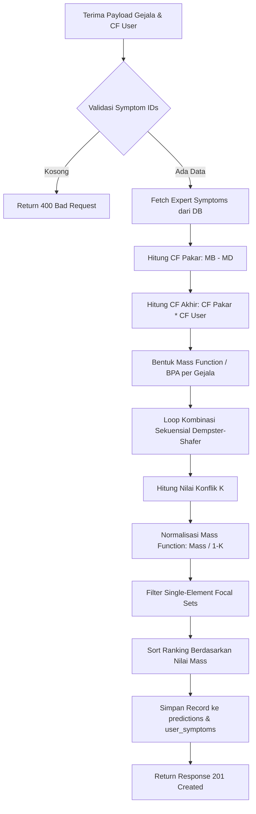

# 🩺 Dokumentasi Spesifik Endpoint `/api/predictions`

Dokumen ini berisi spesifikasi teknis lengkap untuk endpoint `/api/predictions` pada Sistem Pakar Diagnosa Penyakit Rusa. Endpoint ini bertugas mengolah input gejala dari pengguna, menjalankan kalkulasi metode inferensi **Dempster-Shafer (DS)** dan **Certainty Factor (CF)**, serta mengelola data riwayat prediksi.

---

## 📌 Info Umum

- **Base URL**: `http://localhost:8000/api/predictions`
- **Authentication**: Memerlukan `Authorization: Bearer <JWT_ACCESS_TOKEN>` pada semua request.
- **Content-Type**: `application/json`

---

## 📋 Ringkasan Endpoint

| Method | Endpoint Path | Deskripsi Singkat | Hak Akses |
|---|---|---|---|
| `POST` | `/api/predictions/` | Mengkalkulasi algoritma DS/CF dan membuat diagnosa baru | Authenticated |
| `GET` | `/api/predictions/` | Mengambil daftar riwayat prediksi (dukungan Pagination & Filter) | Authenticated |
| `GET` | `/api/predictions/{id}` | Mengambil detail 1 riwayat prediksi berdasarkan ID | Authenticated |
| `PUT` | `/api/predictions/{id}` | Memperbarui field data prediksi | Authenticated |
| `DELETE` | `/api/predictions/{id}` | Menghapus data riwayat prediksi | Authenticated |

---

## 🚀 Detail Specification Endpoint

### 1. 🧪 POST `/api/predictions/`
**Memproses Kalkulasi Diagnosa Penyakit & Menyimpan Hasil**

Endpoint ini adalah **inti dari sistem pakar**. Menerima data Rusa, User, serta daftar Gejala beserta nilai kepastian pengguna ($CF_{\text{user}}$). Server akan mengambil bobot pakar ($MB$ & $MD$), menghitung $CF_{\text{akhir}}$, membentuk *Basic Probability Assignment (BPA)*, lalu mengkombinasikan fungsi massa menggunakan aturan kombinasi Dempster-Shafer ($m_1 \oplus m_2 \dots \oplus m_n$).

#### Request Headers:
```http
Authorization: Bearer <JWT_ACCESS_TOKEN>
Content-Type: application/json
```

#### Request Body Payload (`PredictionCreate`):
```json
{
  "user_id": 2,
  "deer_id": 1,
  "user_symptoms": [
    {
      "symptom_id": 1,
      "cf": 1.0
    },
    {
      "symptom_id": 3,
      "cf": 0.8
    }
  ]
}
```

| Field Name | Type | Required | Deskripsi |
|---|---|---|---|
| `user_id` | `integer` | Ya | ID Pengguna yang melakukan diagnosa |
| `deer_id` | `integer` | Ya | ID Rusa yang didiagnosa |
| `user_symptoms` | `array[object]` | Ya | Daftar gejala yang dipilih (minimal 1) |
| `user_symptoms[].symptom_id` | `integer` | Ya | ID Gejala dari master tabel `symptoms` |
| `user_symptoms[].cf` | `float` | Ya | Nilai keyakinan pengguna ($0.0$ s/d $1.0$) |

---

#### Response Success (201 Created):
```json
{
  "success": true,
  "status_code": 201,
  "message": "Data prediksi berhasil dibuat",
  "data": {
    "id": 15,
    "diagnosis": {
      "disease_id": 1,
      "disease": "Antraks",
      "handling": "Isolasi ketat, berikan antibiotik dosis tinggi, segera hubungi dinas terkait.",
      "mass": 0.4565,
      "percentage": 45.65
    },
    "ranking": [
      {
        "disease_id": 1,
        "disease": "Antraks",
        "handling": "Isolasi ketat, berikan antibiotik dosis tinggi, segera hubungi dinas terkait.",
        "mass": 0.4565,
        "percentage": 45.65
      },
      {
        "disease_id": 2,
        "disease": "Scabies",
        "handling": "Pemberian salep ivermectin, pisahkan dari kawanan, dan bersihkan kandang.",
        "mass": 0.3478,
        "percentage": 34.78
      }
    ]
  },
  "errors": null
}
```

#### Response Error Handlers:

- **400 Bad Request (Gejala Kosong)**:
  ```json
  {
    "success": false,
    "status_code": 400,
    "message": "Minimal harus memilih 1 gejala",
    "data": null,
    "errors": null
  }
  ```

- **400 Bad Request (Tidak Ada Relasi Penyakit)**:
  ```json
  {
    "success": false,
    "status_code": 400,
    "message": "Gejala yang dipilih tidak memiliki relasi penyakit",
    "data": null,
    "errors": null
  }
  ```

- **401 Unauthorized**:
  ```json
  {
    "success": false,
    "status_code": 401,
    "message": "Token tidak valid atau kadaluarsa",
    "data": null,
    "errors": null
  }
  ```

---

### 2. 📜 GET `/api/predictions/`
**Mengambil Semua Data Riwayat Prediksi (Pagination & Filter)**

Digunakan oleh Admin untuk memantau seluruh diagnosa atau oleh Guest untuk melihat riwayat pribadinya.

#### Query Parameters:
| Parameter | Type | Default | Description |
|---|---|---|---|
| `page` | `integer` | `1` | Nomor halaman (minimal 1) |
| `limit` | `integer` | `10` | Jumlah data per halaman (1 s/d 100) |
| `user_id` | `integer` | `null` | Optional. Filter riwayat untuk ID User tertentu |

#### Response Success (200 OK):
```json
{
  "success": true,
  "status_code": 200,
  "message": "Berhasil",
  "data": {
    "items": [
      {
        "id": 1,
        "cf": 0.95,
        "user_id": 2,
        "disease_id": 2,
        "deer_id": 1,
        "user": {
          "id": 2,
          "name": "Peternak Budi",
          "email": "budi@mail.com",
          "role": "guest"
        },
        "disease": {
          "id": 2,
          "name": "Scabies",
          "handling": "Pemberian salep ivermectin, pisahkan dari kawanan, dan bersihkan kandang."
        },
        "deer": {
          "id": 1,
          "name": "Rusa Bawean"
        },
        "user_symptoms": [
          {
            "cf": 1.0,
            "symptom_id": 3,
            "symptom": {
              "id": 3,
              "name": "Gatal-gatal pada Kulit"
            }
          }
        ]
      }
    ],
    "total": 1,
    "page": 1,
    "limit": 10,
    "total_pages": 1
  },
  "errors": null
}
```

---

### 3. 🔍 GET `/api/predictions/{id}`
**Mengambil Detail Prediksi Berdasarkan ID**

#### Path Parameters:
- `id` (`integer`, required): ID Prediksi yang akan diambil.

#### Response Success (200 OK):
```json
{
  "success": true,
  "status_code": 200,
  "message": "Berhasil",
  "data": {
    "id": 1,
    "cf": 0.95,
    "user_id": 2,
    "disease_id": 2,
    "deer_id": 1,
    "user": {
      "id": 2,
      "name": "Peternak Budi",
      "email": "budi@mail.com",
      "role": "guest"
    },
    "disease": {
      "id": 2,
      "name": "Scabies",
      "handling": "Pemberian salep ivermectin, pisahkan dari kawanan, dan bersihkan kandang."
    },
    "deer": {
      "id": 1,
      "name": "Rusa Bawean"
    },
    "user_symptoms": [
      {
        "cf": 1.0,
        "symptom_id": 3,
        "symptom": {
          "id": 3,
          "name": "Gatal-gatal pada Kulit"
        }
      }
    ]
  },
  "errors": null
}
```

#### Response Error (404 Not Found):
```json
{
  "success": false,
  "status_code": 404,
  "message": "Data prediksi tidak ditemukan",
  "data": null,
  "errors": null
}
```

---

### 4. ✏️ PUT `/api/predictions/{id}`
**Memperbarui Field Data Prediksi**

#### Path Parameters:
- `id` (`integer`, required): ID Prediksi.

#### Request Body Payload (`PredictionUpdate`):
```json
{
  "cf": 0.92,
  "disease_id": 3,
  "deer_id": 2
}
```

#### Response Success (200 OK):
Mengembalikan objek `Prediction` yang diperbarui lengkap beserta relasi `user`, `disease`, `deer`, dan `user_symptoms`.

---

### 5. 🗑️ DELETE `/api/predictions/{id}`
**Menghapus Data Riwayat Prediksi**

#### Path Parameters:
- `id` (`integer`, required): ID Prediksi.

#### Response Success (200 OK):
```json
{
  "success": true,
  "status_code": 200,
  "message": "Data prediksi berhasil dihapus",
  "data": null,
  "errors": null
}
```

---

## 🧠 Algoritma Internal `POST /api/predictions` (Alur Kode)



1. **Pengumpulan Himpunan Gejala**:
   - Untuk setiap gejala $G_i$, sistem mencari semua relasi ke penyakit $D_j$ di tabel `expert_symptoms`.
2. **Kalkulasi Kombinasi Masa Awal**:
   $$\text{Mass Focal Set } H_i = \text{Rata-rata}(CF_{\text{pakar}} \times CF_{\text{user}})$$
   $$\text{Mass } \Theta_i = 1.0 - \text{Mass Focal Set } H_i$$
3. **Aturan Kombinasi Dempster ($m_1 \oplus m_2 \dots \oplus m_n$)**:
   - Perkalian silang dua fungsi massa $m_1(A) \cdot m_2(B)$.
   - Jika irisan $A \cap B = \emptyset$, tambahkan ke Konflik $K$.
   - Hasil bagi setiap irisan dengan $1 - K$.
4. **Ekstraksi Diagnosa Utama**:
   - Mengambil focal set dengan elemen tunggal (penyakit spesifik), mengurutkan nilai $m$ tertinggi sebagai **Diagnosis Utama**.
